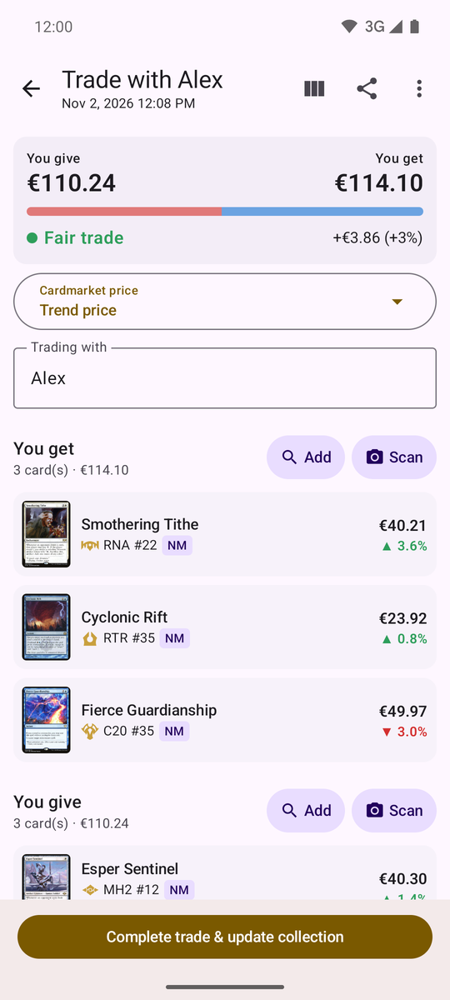
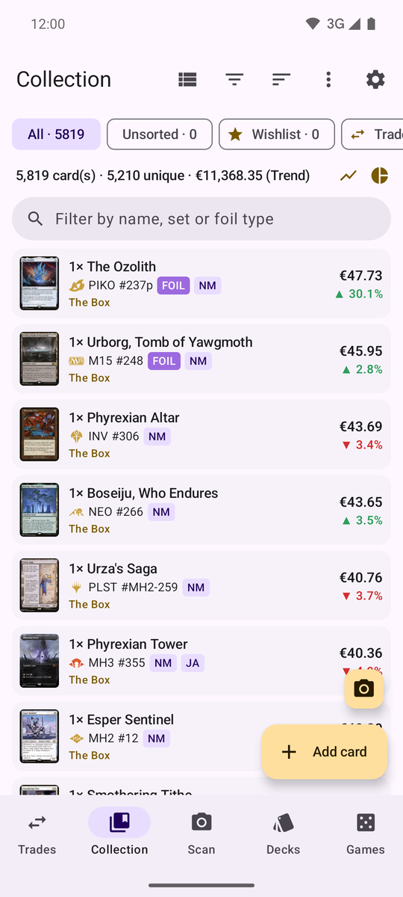
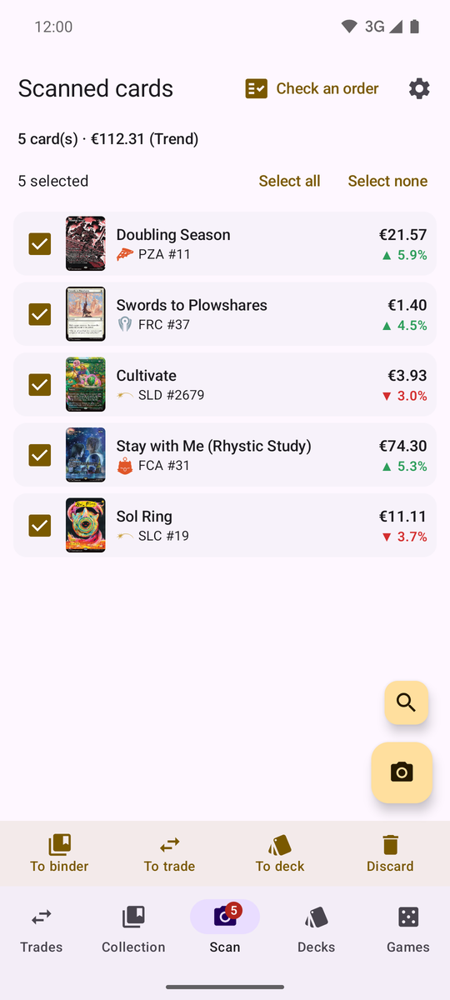
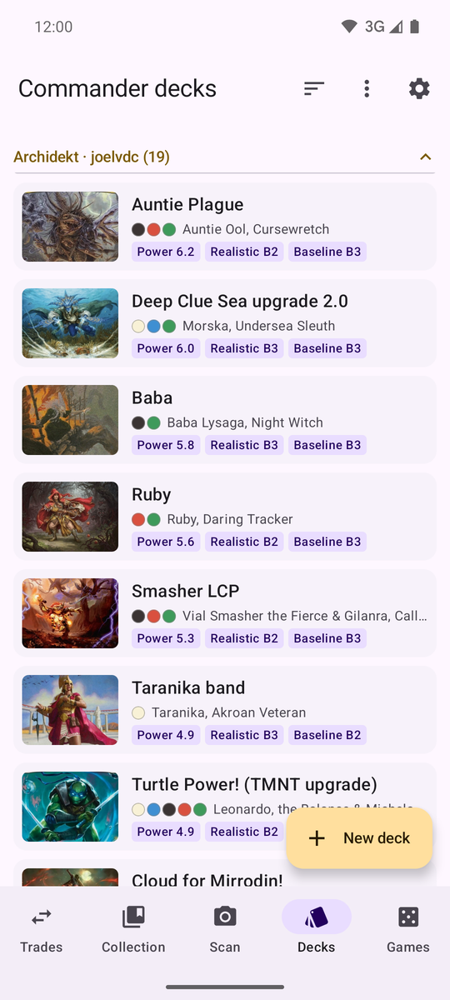
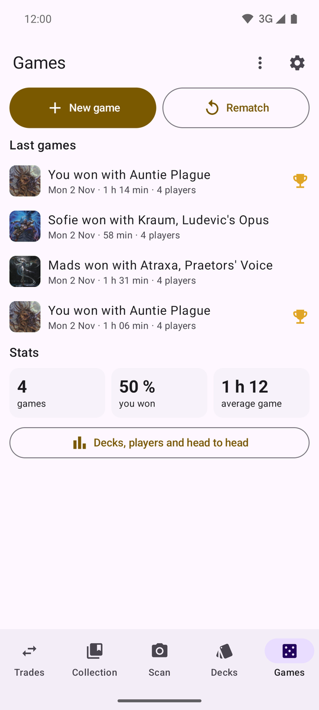
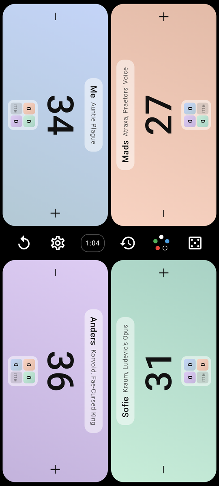
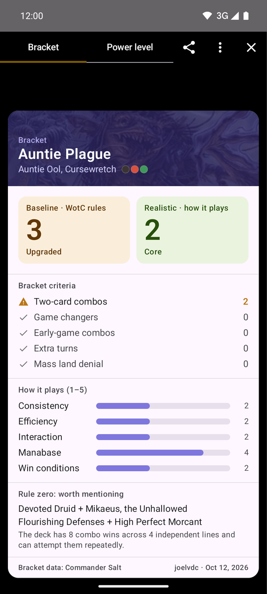
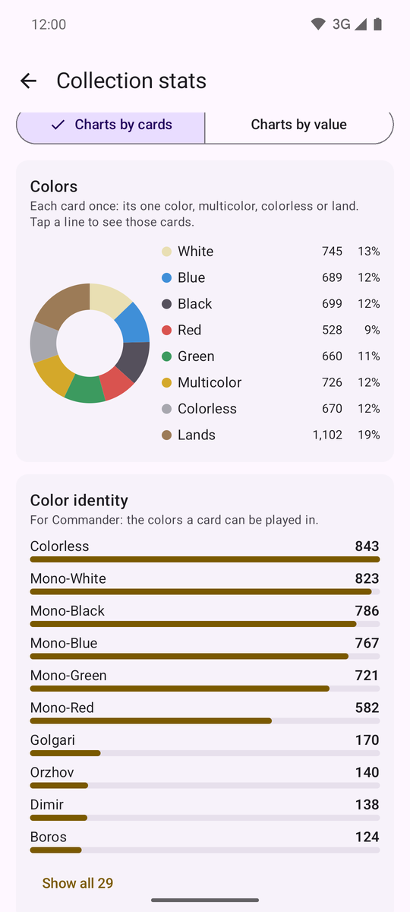

# MTG Trader

An Android app and a website for Magic: The Gathering players: keep your collection and its value up to date, make
fair trades, follow your wishlist and orders, manage your Commander decks and keep score in your games. The phones
and the website stay in sync through your MTG Trader account.

| Trade | Collection | Scan tab | Commander decks |
|:---:|:---:|:---:|:---:|
|  |  |  |  |

| Games | Life tracker | Bracket card | Collection stats |
|:---:|:---:|:---:|:---:|
|  |  |  |  |

## Install

- **With [Obtainium](https://github.com/ImranR98/Obtainium)** (recommended): tap the button above on your phone. It
  installs the app and tells you when there's a new version.
- **By hand:** download `MTG-Trader-<version>.apk` from the
  [latest release](https://github.com/joelvdc/MTG-trading-tracker/releases/latest) and open it on your phone. Use the
  `-universal` file if that one doesn't install. Updates install over the old version and keep your data.

The app works on its own, without an account. An **MTG Trader account** adds sync between phones, the website and
nightly backups; accounts need an invite code for now.

## What it does
**Collection**
- Cards with their printing, finish, condition, language, purchase price, signed and altered, sorted into binders.
- Prices from Cardmarket, TCGplayer or Card Kingdom, in euros, Danish kroner or US dollars, optionally adjusted for
  condition. Value over time, value by set, biggest risers and fallers, what you paid against what it's worth.
- List, compact or picture views; sort in up to three layers; filter by almost anything. Home-screen widgets.
- Stats: colours, identities, rarity, types, mana curve, sets, finish, condition, language and more.
- CSV import and export.

**Scanning and orders**
- Scan a pile of cards with the camera, then send them to a binder, a trade or a deck.
- Import a CardTrader or Cardmarket order with its prices, or a Commander precon.
- **Check an order:** compare the scanned cards with the order file to find missing cards, wrong languages or
  printings, with a problem report for the shop.

**Trades**
- Both sides with their value and whether the trade is fair; completing it updates the collection.
- A **trade binder** suggests spare copies to trade, keeping what your decks need.

**Wishlist**
- To buy, ordered, received; swipe a card along and into the collection.
- Price alerts when a card drops to your price.

**Commander decks**
- Import a deck from a link (read only) or a pasted list, add a precon, or build one in the app or on the website.
- Group a deck by category, card type, mana value or colour, sorted by mana value or name; on the website, drag
  categories into your own order (the app follows it) and drag cards between categories of your own decks.
- Bracket, power level, game changers, combos, mana stats, the chance to cast your commander on time, and a simulated
  win turn.
- Recommendations with the cards you already own marked, filtered by new, owned and card type, sent straight to the
  deck, its maybeboard or the wishlist (a deck from a link keeps a maybeboard of its own in the app and on the
  website); also for all decks at once, to find cards that fit several of them.
- Printable **bracket and power level cards** for rule zero, cards you're missing (to the wishlist),
  and retiring decks you no longer play.

**Games**
- A life tracker for 2 to 6 players with commander damage, poison, counters, turns, dice and a game clock.
- Every game is saved, with win rates per deck and player, head to head and an overview.

**Website** ([mtgtrader.vercel.app](https://mtgtrader.vercel.app))
- The collection, wishlist, scanned cards, orders, decks and trades on a computer, with the same prices and stats as the
  app. Changes reach the phones at their next sync.

## Data
Card data and pictures from [Scryfall](https://scryfall.com); prices from Cardmarket, TCGplayer and Card Kingdom;
brackets and combos from [Commander Salt](https://www.commandersalt.com/); recommendations from
[EDHREC](https://edhrec.com/) and [recommander.cards](https://recommander.cards/); precons from
[MTGJSON](https://mtgjson.com/); exchange rates from the European Central Bank; mana symbols from the
[Mana font](https://mana.andrewgioia.com) by Andrew Gioia.

## Building
Needs JDK 17 or 18 and the Android SDK; run `gradlew assembleDebug`. Tests: `gradlew testDebugUnitTest
verifyRoborazziDebug`. The website is in `web/` (see `web/README.md`); developer notes are in `docs/DEVELOPING.md`.
Release builds are signed with a private key that isn't in this repository, so a build of your own can't update the
official app.

## License and disclaimer
The code is under the [MIT License](LICENSE); that covers this app's code only, not the card data, names or images it
shows.

MTG Trader is unofficial Fan Content permitted under the Fan Content Policy. Not approved/endorsed by Wizards. Portions
of the materials used are property of Wizards of the Coast. ©Wizards of the Coast LLC. Not affiliated with or endorsed
by any of the data sources above. Prices are for guidance only.
