# MTG Trader (Android)

Track Magic: The Gathering trades, check they're fair using Cardmarket prices, and keep your collection up to date.
Keep your Commander decks at hand too, with their power level, brackets and rule-zero cards, organise the collection in
binders, scan piles of cards before deciding where they go, and sync it all between your phones through your own Nextcloud.
Your collection can also be kept the same as your Archidekt collection, both ways, with restore points to go back to.

| Trade | Search | Collection | Compact view |
|:---:|:---:|:---:|:---:|
| 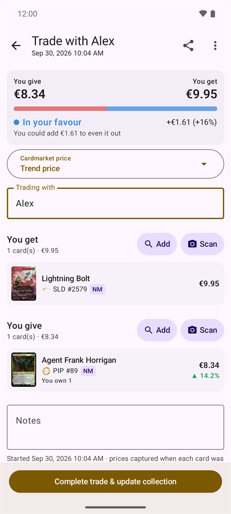 | 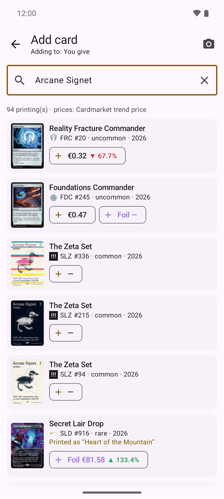 | 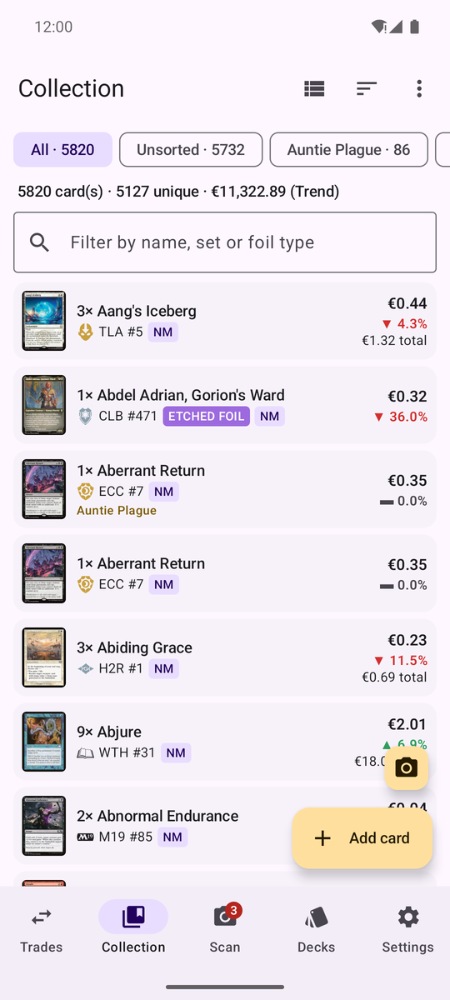 | 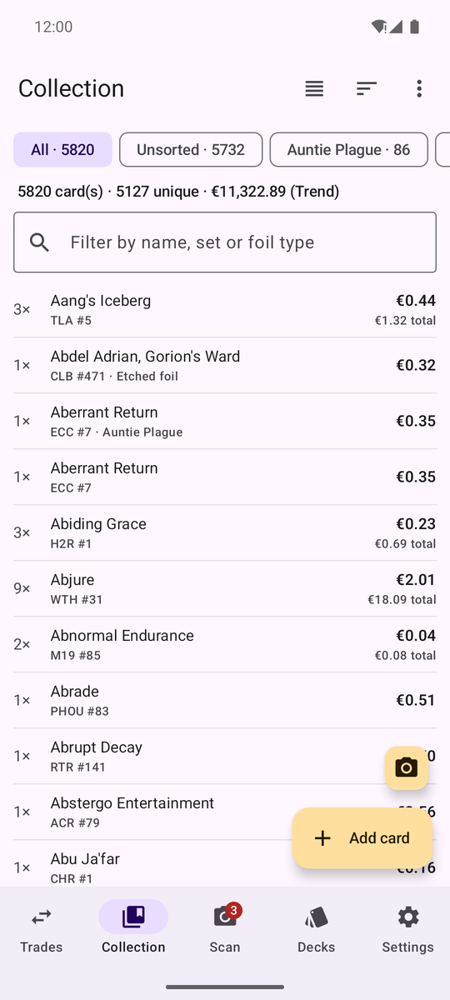 |

| Scan tab | Commander decks | Deck page | Settings |
|:---:|:---:|:---:|:---:|
| 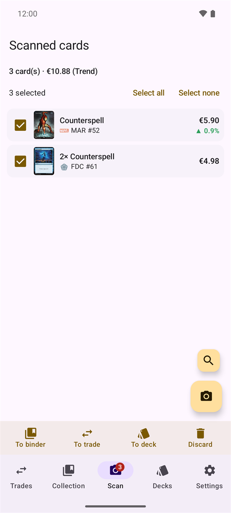 | 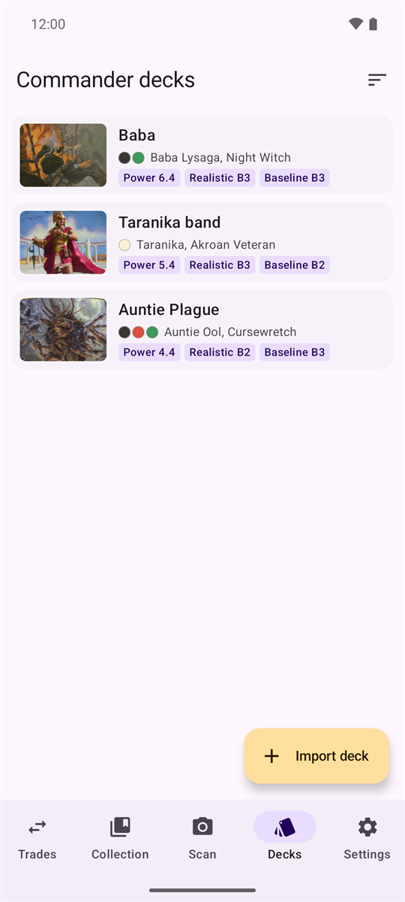 | 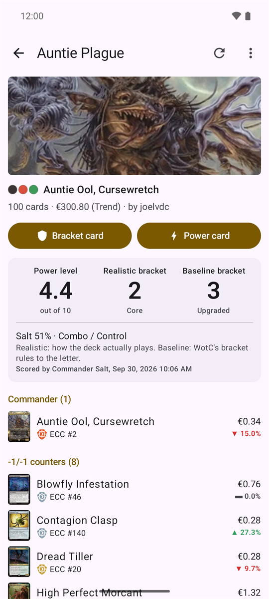 | 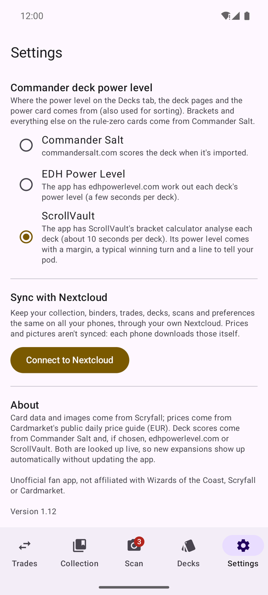 |

| Bracket card | Power card | Card page | Collection stats |
|:---:|:---:|:---:|:---:|
| 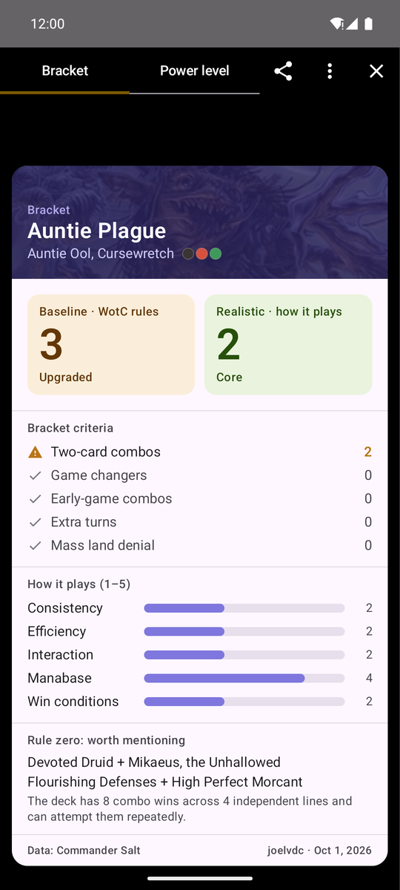 | 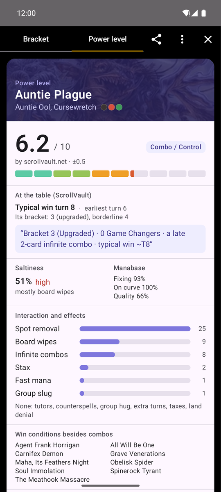 | 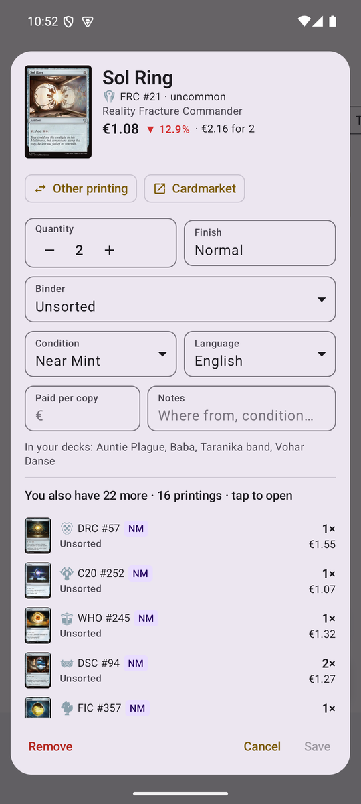 | 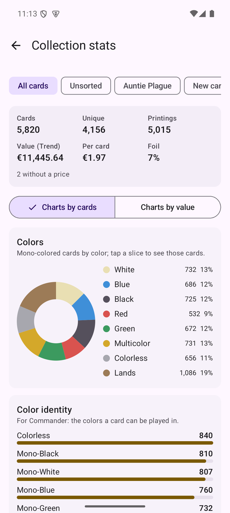 |

## Install
[](https://apps.obtainium.imranr.dev/redirect?r=obtainium://add/https://github.com/joelvdc/MTG-trading-tracker)

**With [Obtainium](https://github.com/ImranR98/Obtainium)** (recommended): tap the button above on your phone, or add
`https://github.com/joelvdc/MTG-trading-tracker` as an app in Obtainium. It installs the app from this page's releases
and tells you when there's a new version. When it asks which file to install, pick `MTG-Trader-<version>.apk`
(or the `-universal` one if that doesn't install).

**By hand:** download `MTG-Trader-1.34.apk` from the [latest release](https://github.com/joelvdc/MTG-trading-tracker/releases/latest)
and open it on your phone (allow "install unknown apps" for your file manager/browser when asked). It's built for 64-bit
ARM phones (practically every phone from the last ~6 years). If it refuses to install, use `MTG-Trader-1.34-universal.apk`
instead (bigger, runs on any device). Either way, a new version installs over the old one and keeps your data.

## Where the data comes from (no app updates needed for new sets)
- **Cards & images:** Scryfall API, looked up live. Pictures you've seen stay saved on the phone and show offline;
  on Wi-Fi the app also saves the pictures of your decks (cards and covers) and wishlist ahead of time (Settings →
  "Save deck and wishlist pictures for offline use", on by default; about 10–15 MB per deck, at most 600 MB in all).
- **Decks:** Archidekt (decklists, and since 1.46 changes to your own decks, sent the way Archidekt's own editor does,
  with your login), Commander Salt (brackets, scores and rule-zero cards) and, if chosen, edhpowerlevel.com
  or ScrollVault (power level). Mana costs come from Scryfall with the cards' other details (once per card, kept on the
  phone) and are drawn with the [Mana font](https://mana.andrewgioia.com) by Andrew Gioia (SIL Open Font License; the
  mana symbols are © Wizards of the Coast).
- **Prices:** Cardmarket's public daily price guide (trend, average, low, 1/7/30-day averages, normal + foil), downloaded
  automatically once a day (~26 MB) when the app opens and in the background. Settings can turn automatic updates off
  or limit them to Wi-Fi; "Update prices now" always runs.
- **Other price sources** (since 1.29): **TCGplayer**'s market prices (in US dollars, they come with Scryfall's card
  data: refreshed daily for the cards you have, and whenever Scryfall sends a card, e.g. in a search) and
  **Card Kingdom**'s public price list (~10 MB a day: its selling price per condition and its buylist). Each source
  downloads once a day (a failed try waits a few hours before the next), with a progress bar above the tabs; since 1.61
  Card Kingdom's list is downloaded first and saved after, so the collection stays open meanwhile. Card
  Kingdom refuses some phones (HTTP 403, e.g. in Denmark); then the app uses a copy that a daily GitHub job
  (`.github/workflows/card-kingdom.yml`, `scripts/card_kingdom_prices.py`) keeps on this repository's
  `card-kingdom-prices` branch (~5 MB). Settings →
  **Price source** picks which one values your cards (collection total, sorting, filters, trades, the trade binder);
  Card Kingdom's follows each copy's condition. A card the source has no price for gets Cardmarket's, shown with "≈".
  Cardmarket's price types and the trend arrows apply to Cardmarket only. The value screen (with a chart per source
  from 1.29 on), the stats ("Value by price source", "Europe or the US?") and each card's page compare all three. These
  prices are kept on the phone only (not synced).
- **Condition-adjusted values** (since 1.33): the price guides have one price per card, whatever its condition.
  Settings → **Count a card's condition in its value** (off until you switch it on) makes a copy count for a
  percentage of the card's price: Near Mint 100%, Excellent 85%, Good 70%, Light Played 60%, Played 45%, Poor 30%, each
  adjustable. It applies everywhere a value is shown (collection, stats, value over time, trades, the trade binder,
  orders), and an adjusted price is marked, e.g. "EX 85%". Card Kingdom's own prices per condition are used as they
  are. The setting and the percentages sync between phones.
- **Currency:** Cardmarket's prices are in euros. Settings → **Currency** shows them in Danish kroner or US dollars
  instead, converted with the [European Central Bank's daily rates](https://www.ecb.europa.eu/stats/policy_and_exchange_rates/euro_reference_exchange_rates/html/index.en.html)
  (downloaded twice a day at most, kept for offline use; the choice syncs between phones). The value-over-time chart is
  converted at today's rate.
- **Typing a price in the currency you paid in** (since 1.40): every field for a price paid or agreed (purchase price
  on a card's page and in the card window, the agreed price in a trade, "Edit condition, language, price…" for
  selected cards, "Add to collection" from the wishlist, what a precon cost, and a wishlist card's alert level) has a
  small **€ ▾ / kr. ▾ / $ ▾** button: type the amount as paid, e.g. 10 in euros while the app shows kroner, and the
  field says what it comes to ("≈ 74,61 kr."). Picking another currency for an amount already there converts it, so
  it keeps its value (since 1.41): 300 kr. becomes 40,21 €, and back again exactly 300,00 kr. The app converts it with the day's rate and keeps it in euros (also
  what totals, Archidekt and CSV files get); alert levels keep the currency typed. A new price field starts on the currency
  you chose last (kept per phone), or the one the app shows.
- **Prices remember the currency they were typed in** (since 1.60): a purchase price or agreed trade price typed in
  kroner or dollars also keeps the amount as typed, so 75 kr. shows as 75,00 kr. (on the card's page, in the card
  window, the trade and Purchase prices from orders) whatever the day's rate, and the field opens on 75,00 kr. again.
  While the app shows another currency, the euros kept are converted as usual. When copies paid in one currency join a
  stack whose price was typed in another (a received wishlist card, an order, a package check, a precon, purchase
  prices from orders), the app asks which currency the stack's average price is kept in. The CSV export adds the
  columns "Purchase price as typed" and "Typed currency", and reads them back. Archidekt only takes one number, so it
  gets euros as before; a price changed on Archidekt comes back in euros.
- **Cardmarket's product list** (~20 MB, once a week): Scryfall links almost every printing to its Cardmarket product,
  but not all. With this list the app finds the missing ones itself (The List reprints such as Urza's Saga, some surge
  foils, older promos) and the separate foil products of special foils such as The Lord of the Rings' silver-foil scrolls.
- **Card details** for sorting, filters and the trade binder (colours, type, mana value and EDHREC's popularity rank):
  from Scryfall, fetched once per card (about a minute for 5,000 cards, the first time).
- **Recommendations:** [EDHREC](https://edhrec.com/) (its public card lists per commander) and
  [recommander.cards](https://recommander.cards/) (its public API, which ranks cards for a decklist).

## Commander decks
**New deck** (Decks tab) starts a deck from **Archidekt**: paste a deck's link, share it to the app from the Archidekt
app or a browser, or pick several decks from someone's Archidekt profile (Select all / Select none); they're scored one
by one in the background. Or make a **local deck** that lives in the app (since 1.46; see below): empty, from a
preconstructed deck, from the cards in the Scan tab, as a copy of one of your decks, or from a pasted Moxfield list.

The Decks tab has three sections, each folding away (since 1.46): **Archidekt** (the decks of the Archidekt account
logged in under Settings, which you can edit), **Archidekt (read only)** (other people's decks, which follow their
owner's changes) and **Local** (decks only in the app). **Add to collection** (deck ⋮ menu) adds the deck's printings to a binder, optionally only the cards you
don't own yet and without basic lands. The app shows the decklist grouped by your Archidekt categories (or by card type) with Cardmarket prices, and
has [Commander Salt](https://www.commandersalt.com/) score it (more below).

**Reading the decklist:** every card shows its **mana cost** in the usual symbols (since 1.43; the set and number are in
the card's window). The view button next to ⟳ (or ⋮ → **Compact view**) switches every deck page between cards with
pictures and **one line per card**, like Archidekt's list: amount, name, mana cost and price, with marks after the name
(✦ foil, **+** added in the app) and the bracket labels (GC for game changer, COMBO, EXTRA TURN, LAND DENIAL in red;
TUTOR, FAST MANA in grey). A long name keeps its room: the labels shorten (TURN, LD, FAST) or become dots (red or grey)
first. Each section heading shows what its cards are worth. Tap a section heading
(a category, or a card type when grouped by type) to fold its cards away and again to show them; ⋮ → **Collapse all /
Expand all sections** does them all. Folded headings stay folded, in every deck that has them (since 1.42).

**Deck stats** (since 1.44): two folding sections above the cards, **Stats** and **Tokens**, folded until you open
them (they stay open or folded for every deck).
- **Mana curve:** the cards by mana value, 0 to 7+, lands left out, with the average.
- **Mana cost:** one bar split by colour, like Archidekt's: the coloured symbols in the cards' costs, with counts and
  shares. A hybrid symbol counts for both its colours, a Phyrexian one for its colour.
- **Mana production:** the deck's **sources** of each colour, the way mana bases are built: each card counts once for
  every colour it can make, however much (Twilight Mire is one black and one green source, Sol Ring one colourless).
  The colours are Scryfall's, with three rules on top: fetch lands count for the colours of the lands they can find
  *in this deck* (Fabled Passage for your basics, Bloodstained Mire for every Swamp and Mountain, Overgrown Tomb
  included); "any colour" cards (Command Tower, Exotic Orchard, Arcane Signet) count only for the commander's colours;
  spells that search for lands (Farseek, Cultivate) don't count. Double-faced cards with a land on either face are
  lands. The switches **Lands only** and **Colourless** sit right on the deck page. Tap a colour to see the cards
  counted, and what each fetch land finds.
- **Tokens:** a picture of every token and helper card (The Monarch, Poison Counter…) the deck's cards make, with the
  cards that make it. Tap one to see it large; **Other printings** lists every printing Scryfall has (online), and the
  one you tap is what that deck shows from then on (since 1.45; **Use the cards' own printing** goes back). Picks are
  kept per deck, survive reloading the deck, sync to your other phones and are saved for offline use.

- **Casting the commander** (since 1.46): a table of the chance, turn by turn (1–7), that the commander can be cast,
  and that each of the deck's colours (and all of them together) is there. The app plays the deck alone 10,000 times
  (a few seconds' work on the phone): a Commander mulligan (one free, then London), a draw each turn (also on turn 1),
  a land each turn (tapped lands come in tapped) and the mana rocks, mana creatures (from the next turn, at once with
  haste) and land ramp spells costing up to 4 cast when they can be (since 1.55 every land they put onto the
  battlefield counts, two for Explosive Vegetation, and Cultivate's other land goes to the hand). No opponents, removal, Treasure, rituals or cost reducers, so it's a
  best case to compare decks and changes by. **How?** explains it and links to Frank Karsten's mana base article, whose
  method it follows with the deck's own cards.
- **Winning the game** (since 1.52): the first turn the deck can win (1% of games or more, in **green**), the turn it
  has won by in 4 of 10 games (in **gold**) and in 9 of 10 games, and a row of the share of games won by each turn,
  starting at the first win (and by a combo, when it has one that can win). The app plays the
  deck alone 10,000 times for up to 15 turns against three players at 40 life, with the mana as above: each turn it
  casts its commander, creatures, token makers, equipment, auras and the cards that deal damage (the most expensive it
  can pay for first), puts the equipment and auras on its commander (or its biggest creature), keeps pump spells for
  combat, and attacks with everything that can (nobody blocks; each attacker hits one opponent, since 1.56). It has won when all three are at 0, a commander has
  dealt **21 commander damage** to each, a combo wins, or **Maze's End** finds its tenth Gate. **Combos** (Commander Salt's, read by what they do since
  1.53): those that win the game or deal infinite damage; endless loops of deaths, creatures entering or -1/-1
  counters when the deck has a card that turns them into life loss (Grave Venerations, The Meathook Massacre, Blood
  Artist for deaths; Purphoros for creatures entering; Obelisk Spider for -1/-1 counters you put); and endless tokens,
  which attack and win the turn after. A combo is finished when its missing cards are in hand with the mana to cast
  them (and the life-loss card, if it isn't out yet), a piece with a {T} ability (Tree of Perdition) has been out
  since the turn before, and what Commander Spellbook lists as needed first is there: other creatures, a card of the
  deck that can start the loop, an opponent's creature (taken as there from turn 4). Combo pieces that are instants or
  sorceries wait in hand for the rest. **Tutors** (Demonic, Vampiric, Worldly…; not land searches) fetch the missing
  piece of the combo closest to done, into the hand or on top of the library. Read from the card text: power, haste, double strike, tokens,
  anthems, card draw, drain and burn, damage triggers on casting spells (Vial Smasher), on creatures or lands entering
  (Purphoros, landfall), at the start of the turn or when attacking, equipment and auras (+N/+N, "for each…", double
  strike, haste, equip costs, For Mirrodin! and living weapon), pump spells (also +X/+X), drawing cards from combat
  damage (Sergeant John Benton), Food, Clue and Treasure makers, and sacrifice abilities like Baba Lysaga's: tapped each
  turn it can, sacrificing the cheapest permanents that cover three card types (tokens first, then spare lands; an
  artifact land counts as two types), for the drain and the cards. In a deck with such an ability every permanent is
  worth casting, as fodder. Since 1.54 also: effects that **count permanents** ("for each Shrine you control", "where X
  is the number of Gates…": damage, drain, tokens, cards, +1/+1 counters, a creature's own +1/+1 for each) and
  triggers when **a kind of permanent enters** ("whenever another Shrine you control enters"; tokens keep their types,
  so Go-Shintai's Shrine tokens count as Shrines); cards that put a Shrine onto the battlefield (Sanctum of All, Hei
  Bai); **Maze's End** (played early, used each turn it can; Gate searches bring real Gates, Sylvan Scrying finds Maze's
  End, Amulet of Vigor, Spelunking and Gond Gate let lands enter untapped; Crackling Perimeter, Basilisk Gate, Sage of
  the Maze, Gatebreaker Ram); sacrifice abilities used the turn they come in (Thousand-Year Elixir, Tyvar, Lightning
  Greaves) and again with untaps (Instill Energy, Nature's Chosen, Patriar's Seal) or Marvin, Liquimetal Coating making
  a permanent an artifact, and the payoffs (Marionette Master, Titania, Baloth Prime and its stun counters, Mazirek,
  lands that leave tokens, fabricate); **X spells** draining each opponent (Exsanguinate, Jaya's Immolating Inferno)
  with the mana left, first when a "first spell each turn" trigger makes them the biggest spell, and Double Vision
  copying the first instant or sorcery. Since 1.55 also:
  - **mana**: ramp spells' every land; **Treasures** as one-use mana (Ganax's for each Dragon, Goldspan's two, Xorn);
    cost reducers ("Dragon spells you cast cost {2} less", affinity, improvise); Urza's and Jaheira's mana; lands and
    rocks pay first, a mana creature only taps when its mana is needed, and a creature that taps for mana or an
    ability (Vohar's loot, Tawnos's copies) **doesn't attack** that turn; Gilanra taps for 6-drops and draws;
  - **pumps**: team pumps from creatures entering or attacking (End-Raze Forerunners, Jubilation), **+X/+X for each
    creature** (Craterhoof, Moonshaker Cavalry), lords of a creature type ("Spirits you control get +1/+0"), pumps
    paid with the mana left (Lathliss), an attacker's own pump (Ruby's +2/+2), **Haunted One** (+2/+0 for the
    commander's creature type), haste for many (Rhythm of the Wild, Hofri, Dragon Tempest), myriad;
  - **damage**: life loss inside longer sentences ("each opponent discards a card and loses 2 life"), "enters or
    attacks" (Archon of Cruelty), X for the number of Dragons (Dragon Tempest, Scourge of Valkas), devotion (Gray
    Merchant), Terror of the Peaks, landfall tokens and counters (Omnath, Avenger of Zendikar), token and death drains,
    attack triggers only when the creature attacks (Cloud's cards and Treasures, Teval's mill);
  - **the graveyard**: mill, looting (the discard picked by rules: in a deck that reanimates a creature it can't cast
    soon, then spare lands), surveil; **reanimation** (the creature worth most, mass reanimation such as Living Death and
    Patriarch's Bidding when the graveyard is worth it), casting from the graveyard (Rivaz, Chainer, flashback),
    "whenever cards leave your graveyard" (Teval's Zombies, Quintorius's Spirits), discard payoffs, Varina;
  - **copies and cheating**: flicker and token copies of the creature worth most on entering (Ghostly Flicker,
    Replication Technique), Tawnos's abilities, polymorph (Jace's −3, Mass Polymorph), Sneak Attack, X token spells;
  - **planeswalkers** (their starting loyalty from Scryfall) use one loyalty ability a turn, a − one when it pays off;
  - **cascade and discover**: the spell found is cast for free and sets off its own triggers, so one cascade can lead
    to another (Apex Devastator, Monstrous Vortex, Maelstrom Nexus, Trumpeting Carnosaur); Aurora Phoenix comes back;
    Improvisation Capstone casts what it exiles; **paradigm** casts a free copy every turn after the first;
  - **Clues and cards drawn**: Clues cracked with the mana left, "whenever you draw your second card each turn"
    (Morska, Alandra), Tangletrove Kelp, Mechanized Production and Hellkite Tyrant as wins, the monarch;
  - **+1/+1 counters**: Leonardo, Mutagens, Corpsejack Menace, High Score, Raphael, counters when attacking;
  - **the opponents' draw steps**: Howling Mine and the like, so "a player draws their second card" (The Council of
    Four), Faerie Mastermind, Scrawling Crawler count.
  Since 1.61 also:
  - **sacrifice payoffs**: with Mirkwood Bats, Marionette Master or Marionette Apprentice out, the Treasures left after
    casting are sacrificed (their mana can still crack Clues), Food ({2}) and Maps ({1}) are cracked with the mana left,
    and Sai sacrifices spare artifact tokens to draw; Nuka-Cola Vending Machine's Treasures, Worldwalker Helm's Maps;
    Tawnos's sacrifice sets them off too; creature tokens are kept to attack;
  - "whenever **a** creature you control enters" damage (Impact Tremors); **populate** and Nesting Dovehawk's counters;
  - a card making several tokens makes them one by one (Whirler Rogue's two Thopters each count for Mirkwood Bats and
    lords); token copies count as tokens made; Tawnos's copies are artifacts, and copy a card token with its abilities;
  - lords that need the **city's blessing** (Illustrious Wanderglyph: ten permanents); creatures without power
    (Ornithopter) are cast when a lord pumps them; **Urza, Prince of Kroog**'s {6} artifact copies.
  Under the table: where the damage came from (combat, commander damage,
  triggers, drain), how often a combo or Maze's End won, and how often commander damage knocked a player out. Decks
  that don't win 4 in 10 games by turn 15 show **T15+** with a note: their damage likely comes from what the app can't
  read (a commander's own ability, opponents' spells, free spells). The opponents only draw their cards; no removal or blockers, so it's a best case to compare decks by. **How?** lists what was
  counted. Worked out in the background (a few seconds) and kept on the phone until the deck, its card details or its
  combos change.

The stats use the card details the app keeps from Scryfall; decks' cards get the new ones once, the first time a deck
page is opened online after updating to 1.44.

**Maybeboard:** ⋮ → **Show maybeboard** lists the deck's maybeboard on Archidekt (and any other category Archidekt
leaves out of the deck, such as a sideboard) under the deck, by category and with prices. It's never counted in the
deck's cards or value, "Cards I'm missing", "Add to collection", "Cards in several decks" or what the trade binder must
keep. It's loaded with the deck (decks loaded before 1.42 get it at their next reload) and saved on the phone, so it
shows offline and syncs with the deck.

**Adding cards:** **+ Add card** on a deck page opens card search (and from there the scanner) for that deck; the Scan
tab's **To deck** and **Recommendations** add cards too. On a deck you can edit (below) they go straight into the deck,
in their auto category. On other people's decks they're added in this app only, under "Added in app": Archidekt isn't
changed, and they stay when the deck is reloaded. Tap such a card to remove it again.

**Editing decks** (since 1.46): your own Archidekt decks (of the account logged in under Settings → Archidekt) and
local decks can be changed in the app; other people's stay read only.
- Each card has a **drag handle** (⠿): drag it onto another category. **Press and hold** a card to select it, tap more,
  then **move** them to a category (or **Auto**: each card's Archidekt auto category, or a new one), put them in the
  **maybeboard** or back, or **remove** them.
- A category's **⋮**: add a card right there, select all its cards, rename it, or delete it (its cards go to their
  auto categories or another category). The deck's ⋮ menu has **Manage categories…** and **Auto-categorise all cards**.
- **Manage categories** (since 1.47): add categories, rename or delete them, and switch off the ones you don't want to
  see. A switched-off category is left out of the category lists when moving cards, and its cards show in one folded
  **Hidden categories** section at the bottom of the deck page. Categories without cards are never shown on the deck
  page; give one its first card from a card's page or with **Move to category**. On an Archidekt deck, adding,
  renaming and deleting a category happen on Archidekt too.
- Tapping a card shows its **category** (tap it for the list of categories, from the bottom of the screen), **In the
  deck or Maybeboard** and the number of **copies**.
- Cards "Added in app" on your own deck can go **Into the deck** or **To maybeboard** with one tap.
- **Auto categories** are Archidekt's own (Ramp, Draw, Removal…, from its card data); cards without one go by card
  type, as on Archidekt. Settings → **Auto categories for new cards** turns them off for new cards.
- Every edit can be **undone** right after. On an Archidekt deck it shows at once and goes to Archidekt in the
  background, the way Archidekt's own editor sends it. Offline (or logged out) the edits wait on the phone, with a note
  on the deck, and go once the phone is online again (**Send now**, or Decks tab ⋮ → **Send waiting edits now**). Only
  the phone that made an edit sends it; the other phone gets the changed deck through the sync. An edit Archidekt
  refuses (e.g. the card was removed there meanwhile) is skipped and reported. A deck isn't reloaded from Archidekt
  while edits wait. Decks loaded before 1.46 are reloaded once before editing, to learn Archidekt's ids for their cards.
- Deleting a deck in the app never deletes it on Archidekt; Archidekt decks are deleted on Archidekt's website.

**Local decks** (since 1.46) live in the app (and on your other phone through the sync). Make one with **New deck**:
**Empty deck** (add the commander, then put it in the Commander category), **From a preconstructed deck** (any Commander
precon on MTGJSON, every card in its printing), **From scanned cards** (the Scan tab's **To deck** offers **New local
deck** too), **Copy of one of my decks**, or **Paste a Moxfield list**: Moxfield's export text (also Archidekt's,
MTG Arena's or a plain "1 Sol Ring" list) is read with the exact printings where it names set and number, foils
(\*F\*) and its headings (Commander, Sideboard, Maybeboard); if the list has tags, choose whether they become the
categories or Archidekt's auto categories are used. Any Archidekt deck can be **detached** (deck ⋮ menu) into a local
deck, and importing a link can make it a local deck right away. A local deck's ⋮ menu has **Send to Archidekt…**: as a
**new deck** of your account (name, one of your Archidekt **folders**, and who can see it: private, unlisted (the
default) or public; Commander Salt can't score a private deck), or **into one of your decks** (adding its cards, a card
in both keeping the higher number, or replacing that deck's list). Your own Archidekt decks have **Folder and
visibility…** to move them to another folder or change who can see them. Deleting a local deck is for good (with an undo
right after).

**Your printings:** the decklist shows each card in a printing you own rather than the one on Archidekt (the deck on
Archidekt isn't changed). The app takes a copy in the binder named after the deck if there is one, else Archidekt's
printing if you own it, else the printing you own most copies of (outside the trade binder if possible); cards you don't
own and basic lands keep Archidekt's printing. The deck's value follows. Tap a card to pick which of your copies to show,
use Archidekt's printing for that card, or let the app choose again; picks survive reloading the deck and sync to your
other phones. "Show Archidekt's" above the list (or ⋮) switches a deck back to Archidekt's printings.

Commander Salt gives:
- **Power level** (out of 10), **realistic bracket** (how the deck actually plays) and **baseline bracket** (WotC's
  bracket rules to the letter), plus saltiness and archetype.
- The **bracket** and **power level rule-zero cards**, drawn by the app from Commander Salt's analysis: the brackets
  and the criteria behind them (game changers, two-card combos by name, extra turns, land denial), how the deck plays,
  saltiness, manabase, interaction counts and win conditions. They're shown full screen (screen kept on at full
  brightness) to show your table, shareable as images, and work without a connection. Commander Salt's own card
  images are still one tap away (⋮ → "Show Commander Salt's original").

**Power level source** (Settings): Commander Salt, [EDH Power Level](https://edhpowerlevel.com/) or
[ScrollVault](https://scrollvault.net/tools/commander-bracket/). The other two sites have no API, so the app opens their
calculator out of sight and reads the result (a few seconds per deck; on ScrollVault's page the ads and trackers aren't
loaded). The chosen power level is used everywhere, including the power card and sorting; brackets and everything else
stay Commander Salt's. With ScrollVault, the power level comes with its margin (e.g. 6.2 ±0.5), and the power card and
deck page add what it found "at the table": the typical and earliest winning turn from its goldfish simulation, its own
bracket call (and whether it's borderline) and its "tell your pod" line.

**Bracket-relevant cards** are tagged right in the decklist: game changers, combo pieces, extra turns and land denial
(WotC's bracket rules, in red) and tutors and fast mana (in grey), with a count above the list and **Only these cards**
to list just them. Tapping a card names its combo partners and the other decks it's in.

**Combos** (since 1.46): every combo Commander Salt finds is flagged, not only those it counts for the bracket:
**COMBO 2** for two cards, **COMBO 3+** for three or more, **red** when it counts for the bracket (two-card and
early-game combos) and **blue** when it doesn't (e.g. a two-card combo that needs more on the battlefield). A card in
several combos shows the smallest of each colour; in the compact view the flags shorten to C2 / C3+ and then a dot when
a long name needs the room. Above the list: "Combos: 8, of which 2 count for the bracket". Tapping a card lists each of
its combos, whether it counts, what it does, and a link to it on Commander Spellbook.

**All decks' cards** (since 1.46; Decks tab ⋮ → **Bracket cards of all decks** / **Power level cards of all decks**):
every one of your own decks' (Archidekt and Local) bracket or power level card as a small card, in the Decks tab's order;
tap one for the full cards and swipe from deck to deck. Decks not scored yet are listed at the bottom. Since 1.52 each
small bracket card has a third tile with the turn the deck wins by in 4 of 10 games (since 1.54; **T11**, or **T15+**),
and the full bracket card has a **Speed** section under the two brackets: that turn (gold), the first turn it can win
(green), 9 in 10 games, the share won by each turn and where the damage came from (see Winning the game under the deck
stats).

**Recommendations** (deck page, or the deck's ⋮ menu): cards for the deck from **EDHREC** or **recommander.cards**
(switch at the top; the choice is remembered). EDHREC's are in its own sections (New Cards, High Synergy, Top Cards, Game
Changers, Creatures, Instants…), each card with how many of the commander's decks play it and its synergy; its New Cards
section lists every recommended card first printed in the last year, not just five. recommander.cards ranks cards for
the actual decklist and shows them in its categories: Top Recommendations, New Cards, Ramp, Spot Removal, Mass Removal,
Card Advantage, Tutors, General Staples, the card types, Utility Lands and Lands (its API gives only names and scores,
so the app sorts the cards into those categories from their rules text and type). Cards already in the deck are left
out. Filter by card type, by **I own / I don't own** and by **New cards**; tap a card for its prices and to add it to the
deck (kept when the deck reloads) or to the wishlist. **Recommendations for all decks** (Decks tab ⋮ menu) asks for every
deck at once and shows the cards you already own that fit your decks, or the cards recommended for several decks.
Tap a card's picture to see it large and swipe left or right through the list, with its type, the source's numbers,
price and how many you own under each (double-faced cards can be flipped there too).
Recommendations are saved, so they show straight away and offline; ⟳ asks again.

**Cards I'm missing** (deck ⋮ menu) lists the deck's cards you don't own in any printing, with what buying them costs;
add them all to the wishlist, or share/copy them as a plain list ("1 Card name" per line) for a Cardmarket wants list.
**Cards in several decks** (Decks tab ⋮ menu) shows which cards your decks share and whether you own enough copies for
all of them.

The deck list can be sorted by name, power level, bracket (realistic, then baseline) or when the deck was last changed on
Archidekt, highest/newest first or reversed. On a deck page, **Refresh bracket and power level** scores the deck again on
Commander Salt and the chosen power level site; if the deck changed on Archidekt since it was loaded, its list is
reloaded first, so the list and the scores always belong together. **Reload decklist from Archidekt** (the ⟳ icon, or
the deck's ⋮ menu) always reloads the list and scores it again. On the Decks tab (⋮ menu), **Update all decks from
Archidekt** checks every deck and reloads and re-scores only the ones that changed, **Re-score all decks on Commander
Salt** has Commander Salt score every deck again (nothing else), and, when the power level comes from EDH Power Level
or ScrollVault, **Re-score power levels** asks that site again for every deck. Cards moved to the
Maybeboard on Archidekt leave the deck. Commander Salt has no official API: the app uses the
same calls as its website, so this part may break if the site changes. Importing a deck adds it to commandersalt.com.

## Binders
The collection can be split into binders (like ManaBox): the bar above the list shows **All**, **Unsorted** (cards in no
binder) and each binder with its card count. From the ⋮ menu you can create, rename, delete and **merge** binders (e.g.
a temporary "new cards" binder into your main one; identical cards are combined). Tap a card to move it, or some of its
copies, to another binder. Completing a trade asks which binder the received cards go into (or makes a new one); given
cards are taken from Unsorted first. CSV import/export carries a "Binder Name" column.

**Arrange binders:** ⋮ → **Arrange binders…** lists Unsorted, the Wishlist and every binder; move each up or down with
its arrows. The bar above the collection and the binder lists ("Move to", "Put them in"…) follow that order; **All**
always comes first and new binders go at the end. The order is synced to your other phone.

**Selecting cards:** press and hold a card (in any view, or ⋮ → **Select cards**), then tap more; **Select all shown**
picks every card the search and filters show. The bar at the top shows how many cards and their value, with:
- **Move to binder…** (or a new binder);
- **Add to a trade:** on the "You give" side of an open trade or a new one, every copy;
- **Delete:** asks first and makes a restore point (see Backups);
- under ⋮: **Edit condition, language, price…** (only what you change is changed; stacks that become the same are
  combined), **Share as a list**, **Copy as a list** and **Export as CSV** (only the selected cards).

Every action can be undone right after.

**Swiping cards** (list and compact views): **swipe right = Move to binder…**, **swipe left = Add to a trade…** by
default; for a stack of several copies, the window asks how many. Settings → **Swiping cards in the collection** sets
each direction to: move to binder, add to a trade, into or out of the trade binder, one copy more, one copy less, add
to the wishlist, or nothing. Every swipe can be undone.

**Import an order:** ⋮ → **Import an order (CardTrader, Cardmarket)** and pick the order's file. The app finds every
card on Scryfall (tokens, The List and collector's sub-sets included) and shows the order first: untick what you
don't want, and leave out tokens and basic lands with the two switches (both on by default). Cards it could only find
by name say **Check the printing**, and the ones it couldn't find at all say **Find the card**; tap either to pick the
printing yourself. Choose a binder (or make a new one, named after the shop and date) and tap **Add**: the cards keep
the order's finish, condition, language and the price you paid per copy. Signed and altered cards are marked so (see
below). When a card joins copies you already have in that binder, the stack gets the average paid, weighted by copies.

**The order and your wishlist:** after **Add** (and after adding a checked package), cards of the order that are on your
wishlist (to buy, ordered or received) are listed: for each, **Received** (preselected), **Take off** or **Leave**, or
the same for all at once. "Any printing" wishlist cards match by name, "this printing only" ones by printing and finish;
each copy bought counts once. Marked as received, a card stays on the wishlist as a record, linked to the order
("✓ received Oct 20 · CardTrader order #12345"), and won't be added to the collection again. Of a card bought fewer
times than wanted, the bought copies get an entry of their own and the rest stays wanted.

The order files the app reads (it tells them apart by itself):
- **CardTrader:** the order's Excel export (`.xls` or `.xlsx`).
- **Cardmarket, one shipment:** the "ArticlesFromShipment…" CSV from the shipment's page. It names cards by
  Cardmarket's product number, with condition, language, foil, signed and altered. A playset counts as four cards at a
  quarter of its price each.
- **Cardmarket, one month:** the "Purchased Articles" CSV (Account → Statistics). It has names and prices but not
  foil, language or condition, so it suits purchase prices (below) better than importing.

**Purchase prices from orders:** ⋮ → **Purchase prices from orders…** and pick one or several order files. The app
finds the cards in your collection (nothing is looked up online) and shows what would change before anything does:
- a card gets the **average paid**, weighted by copies, and every copy in the stack gets it;
- a card that **already has a price** keeps it, unless its stack holds more copies than the orders cover: then the
  bought copies are averaged in (4 copies at €2 and an order for 1 at €4 make €2.50). **Overwrite** replaces instead;
- **Your choice** lists purchases the file can't pin to one of your cards (you own the printing in foil and non-foil
  or in two languages and the file doesn't say, the finish or language differs from the order, or you own the card as
  another printing): tick the cards the purchase was for, or leave them;
- cards you no longer own are listed under **Not in the collection** and left alone.

Untick any card to leave it as it is. A restore point is made before the prices are set.

**Orders:** ⋮ → **Orders** is the history of what you bought: every order you import, every package you check and
every precon you add is remembered with its date, what you paid and what its cards are worth now (whether you still
have them or not). Tap an order for its cards, to change its date or to remove it from the list (your collection
stays as it is). **+** adds the files of orders from before, several at once (CardTrader's Excel, Cardmarket's
shipment or monthly CSV; a month becomes one order per shipment): they only go into the list, the collection isn't
changed. A shipment file has no date in it, so the import asks for one. Orders sync between phones and are part of
backups.

**Add a preconstructed deck:** ⋮ → **Add a preconstructed deck…**, pick the Commander deck (search by name or set
code; the lists come from [MTGJSON](https://mtgjson.com/)), then the binder, what you paid and the day. The deck's
cards go into the binder in their own printing and finish, without basic lands. What you paid is split over them in
proportion to what each card is worth today, so the cards add up to what the deck cost; a card you already had in
that binder gets the average. The deck is remembered as an order.

The collection can be shown as a **list** (default), **compact** (one text line per card) or **cards** (a grid of
big card pictures); pick it with the view button next to Sort. Prices show the value of one card, with the stack
total underneath, and "Value per card" sorts by it.

**Sort** in layers: e.g. color, then name; or type, then mana value, then name; up to three levels, each with its own
direction (A to Z / Z to A, highest / lowest first…), with shortcuts for the usual ones. Sort by name, color (W, U, B, R,
G, multicolor, colorless, lands), type, mana value, rarity, set, collector number, value per card, date added, copies,
or how the price moved lately: **Change in %** and **Change in money**, biggest rise or biggest fall first. The change
is Cardmarket's trend price against its 30-day average for one copy (also while TCGplayer or Card Kingdom is your price
source); cards without a 30-day average go last.

**Filter** (the button next to Sort) for what's awkward to type: colors (has any of them, exactly these, or fits in a
color identity), type, rarity, sets (pick from the sets you own), finish, signed or altered, condition, language, value
range and whether the card is in one of your decks. The active filters show as chips under the search field (tap ✕ to
drop one); the search field still finds cards by name, set or foil type (and "signed" or "altered").

Tap a card to open its **card page**: picture, price and trend, then compact fields for quantity, finish, binder,
condition, language, the **purchase price** per copy and **notes** (condition details, where it came from). With a
purchase price the page shows what you paid against what it's worth now; both go into the CSV export and are read back
on import. The page also lists the decks the card is in and **the other copies you own**: other printings, finishes,
conditions and binders, the same printing first and then by value. The first three show; tap the header or "Show all"
for the rest (the app remembers), and tap one to open its page. Cardmarket's prices are folded into one line; tap it
for the full table.

**Signed and altered cards:** tick **Signed** or **Altered** on the card page. Like etched foils, they're a stack of
their own, with a SIGNED or ALTERED tag in the list. Ticking one on a stack of several copies asks how many: with 4
Brainstorms of which 1 is signed you get a stack of 3 and a signed one. Both carry over in CSV export and import
("Signed" and "Altered" columns; ManaBox's "Altered" column is read too), Nextcloud sync, backups and Archidekt sync. The
trade binder never suggests a signed or altered copy (one you put there yourself stays).

Tap a card's picture (in its card window, search, decks, the scanner…) to see it full screen; pinch or double-tap to
zoom. Double-faced cards (modal double-faced cards like Bala Ged Recovery, transform cards) get a **Flip** button to see
the back.

**Collection value over time:** tap the total above the list (or ⋮ → Collection value over time). The app saves the
collection's value once a day, so the chart fills in as days go by (1 month, 3 months, 1 year, all); underneath are the
cards whose price is rising or falling most lately, per card (one copy, the same change the collection can be
sorted by); tap one to open it. **Paid and worth** compares what you paid for the cards that have a purchase price
with what they are worth now, for all cards or the chosen binder, with your best and worst buys per card. The chips at the
top switch between all cards, Unsorted and each binder (binder values are saved from version 1.25 on).

**Collection stats:** the pie-chart button next to the total. For the whole collection or one binder (chips at the
top), with the charts counting either cards or value:
- totals: cards, unique cards, printings, value, value per card, share of foils;
- the **color pie** (white, blue, black, red, green, multicolor, colorless, lands) and **color identity** groups for
  Commander (mono-colored, guilds, shards and wedges, four- and five-color);
- **rarity**, **card types**, the **mana value** curve of non-land cards, the **top sets** and cards per **release
  year** (with your oldest card);
- how many of your cards are **in a deck**, plus **finish**, **condition**, **language** and value per **binder**;
- your **most valuable** cards, your cards that are **most played on EDHREC**, and the **Game Changers** you own.

Tap a slice or bar (Golgari, Mythic, Instants, a set…) to see exactly those cards in the collection.

## Trade binder
⋮ → **Make a trade binder** suggests what to put in a "Trade binder": only spare copies (what your decks use stays home,
and wishlist cards and basic lands are left out), ranked by value and by how much Commander players want them (EDHREC's
popularity rank), with a nudge for rising prices. Set the most cards it may hold, the minimum value (any value, €0.50,
€1, … or your own) and whether to keep at least one copy of each card. **Keep the best copy for my decks** (on by
default) offers the cheaper spare copies of cards your decks use, so the most valuable or fanciest one stays with the
deck; **…of every card** does the same for all cards. **Swap** on a suggestion lists your other copies of the card
(printing, finish, condition, language, and where they are) to put in the binder instead; the app remembers your pick.
Tap a suggestion to open the card. Later, **Update trade binder** (⋮ menu, or the button in the binder) shows what to put in
and what to take out (a deck uses the card now, it dropped below the minimum value, better cards pushed it out…) with
the reason for each; untick what you don't want, then apply. Unticked suggestions aren't made again (⋮ to undo that).
Copies are taken from Unsorted and other binders before binders named after a deck, and cards taken out go to Unsorted,
for you to sort them from there. On the card page of a card in the trade binder, **Swap in** next to another copy you
own puts that copy in the trade binder instead (the one taken out goes to Unsorted), and later updates keep it. Nothing changes until you apply.

## Wishlist
The **★ Wishlist** in the binder bar holds the cards you want. Add them with "Add card" or the scanner while it's
selected, or from a deck's "Cards I'm missing". By default any printing will do; it can be limited to one printing and
finish. Each card shows whether you own it. Cards on the wishlist get a ★ when they're on the "You get" side of a
trade. The wishlist isn't part of the collection's value, can be shared as a list and is synced.

**Sections:** the wishlist shows **To buy**, **Ordered** and **Received**, each with its card count; tap a section's
header to fold it away (Received starts folded). With "Ordered cards in their own section" off (the view menu, top
right) it's one list with the ordered cards last, and Received below.

**Swiping right moves a card one step on:** **To buy → Ordered → Received → the collection.** A received card is kept in
the Received section with the date ("✓ received Oct 20"), as a record: it no longer counts as wanted (no ★ in trades,
no price alerts, not in the total or the shared list). Swiped right in Received, it goes into the collection: a window
asks the printing (to confirm for "any printing" cards, to pick for cards added offline; the list needs internet),
finish, condition, language, copies, binder and, if you like, what you paid. Copies of a version you already have in
that binder join its stack, whose purchase price becomes the average of all copies (when the two prices were typed in
different currencies, the app asks which one to keep it in). The card then leaves the
wishlist. When its copies are in the collection already (it came with an imported order, or was added when received),
swiping right just takes it off the wishlist; and when the app sees you got a copy since adding it, the window warns
and offers **Just take it off the wishlist**. **Swipe left** to delete a card. A swipe counts once it's gone 40% of the
way, the colour behind the card shows what it will do, and every swipe can be undone. The ⋮ menu has:
- **Mark all ordered cards as received.**
- **Mark the cards I now own as received:** the app remembers how many copies you owned when you added a card; cards
  you now own more of (from an order import, a trade, the scanner…) are shown in a list first, then marked. A card
  you got only some copies of keeps the rest as wanted. It's greyed out while none of your wishlist cards is in your
  collection yet.
- **Clear received cards.** They're kept until you do, or, in Settings → **Received wishlist cards**, after 1, 3, 6 or
  12 months.

Received cards aren't added to the collection when marked (your order imports do that). Settings → **Add received cards
to the collection** adds them to Unsorted (near mint, their printing) right away instead, for many at once; they're then
marked "added to the collection", so swiping them on doesn't add them a second time.

**Selecting:** press and hold a card (or ⋮ → **Select cards**), then tap more. The bar at the top shows how many and
their value, with **Ordered**, **Received**, **Delete** and, under ⋮, **Back on the wishlist**, **Not ordered**,
**Share as a list** and **Select all shown**. ✕ or Back stops selecting.

**Ordered cards:** tick the "Ordered" box on the right of a wishlist card once you've bought it (or "Ordered, on its
way" in the card's window); Undo takes back a mis-tap. The card is then faded and shows "📦 ordered" with the date, the
line above the wishlist counts it as ordered instead of still to buy, and it's left out when you share the wishlist (so
it isn't bought twice). Once it has arrived, swipe it to the right to mark it as received.

**Price alerts:** open a wishlist card and fill in "Notify me at or below" (in any currency, with the button in the
field, which converts the level when you change it; empty means no alert). The level keeps the currency you typed it in, so 300 kr. stays 300 kr. whatever the day's exchange
rate (levels set before 1.39 were kept in euros: type them again once). When the card costs that much or less you get one notification ("Ragavan: €38.50 · CardTrader (2X2, SP,
EN) · your level: €40.00"); tapping it opens the card. You're told once per drop: a new notification only comes after the
price has been above your level again, or when you change the level. Ordered cards stay quiet. Prices are checked after
each price update (when the app opens, and every few hours in the background, so "Update automatically" must be on);
Android 13 and later ask once whether MTG Trader may send notifications. "Any printing" cards are compared at their
cheapest printing (looked up on Scryfall once a day). The list shows each card's alert prices under it: "🔔 €40.00 ✓"
(✓ once reached), "Low from €41.50 (MH2)", "CT Zero from €38.50". The level is synced; each phone notifies by itself.
Settings → **Wishlist price alerts**:
- **What's compared:** the price source chosen at the top. With Cardmarket, you choose its price for alerts: lowest
  listing (the default), trend price, 7-day or 1-day average; the menu explains each.
- **Also check CardTrader:** each wishlist card also shows CardTrader's cheapest offer, with "Open on CardTrader" in the
  card's window (the page of the printing with that offer), and alerts count it too. It needs your personal CardTrader
  API token (cardtrader.com → your profile's settings → API), kept encrypted on the phone and not synced: enter it on
  each phone; "Save and check" asks CardTrader whether it works. You choose the language and the worst condition that
  count. Signed, altered and graded copies, bundles and sellers on holiday are left out; prices don't include shipping.
  Up to 25 printings per card are asked, the cheapest first; a card's CardTrader price is looked up again every 5 hours.
- **Only CardTrader Zero offers** (on by default): only offers you can buy through CardTrader Zero count; the cheapest
  from any seller shows next to it in the card's window. CardTrader's API shows a printing's 25 cheapest offers (in the
  chosen language and finish); when none of them is CT Zero, the card shows "CT Zero over €…", the price of the dearest
  of those 25, since a CT Zero copy costs at least that.

**Offline:** without internet, "Add card" on the wishlist suggests names from Cardmarket's card list saved on the phone
(the one the app downloads for prices; no extra download). The card goes on the wishlist by name, as "any printing",
marked "Details follow when you're online"; its picture, set and prices are filled in by themselves once the phone is
back online.

## Games: life tracker and game records
The **Games** tab (since 1.47; Settings moved behind the ⚙ at the top of every tab) keeps score in Commander games and
remembers them.
The tracker looks and works like the Lifetap app (since 1.48): soft colours with dark text, a menu bar across the
middle of the table, and everything about the game (counters, settings, dice, mana, history) inside the game.
- **New game:** 2 to 6 players, who sits where (clockwise) and which deck each plays: yours are the app's decks;
  friends are added as players with their own decks (a commander, or two partners, found on Scryfall, and optionally
  the Archidekt link). A guest (no player of their own) can pick just a commander, and a partner (since 1.58): their
  panel gets its picture and colours, and the stats count it like a deck. Who starts: picked, or at random with a run
  around the table that slows down before it stops (about 3 seconds); without turns counted, the player who starts
  has a gold **1st** badge on their name label until the first change in the game (since 1.58). **Rematch** sets up the
  last table again. Starting life and the game's other settings are set in the game.
- **The table:** the phone lies in the middle; each player's panel faces them, in a soft colour (or their commander's
  picture), with their name on a label, their life with room around it, − and + at the ends, and the **commander
  damage mini-grid**: a tiny copy of the table in a light frame, centred under the total (as in Lifetap), each box the
  damage taken from that player's commander (partners split in two, "0|4", by themselves when the deck or guest has
  two commanders); their own seat says "me" until their own
  commander has dealt them damage (say when another player controls it). Counters in use show as small badges beside
  it. The name, total and grid stay in one line on narrower phones too (since 1.51); only the short seats at the ends
  of a 5–6 player table have the grid right beside the total, with the total in the middle. Tap left of the total
  for −1 and right for +1 (or below/above), hold for 10 (or by 1, fast); the change shows next to the total for a
  moment. At low life (a quarter of the starting life or less: 10 at 40) the panel shows an animation (a ghost
  rising between the total and the +, a dark edge, a cracking total, or none). At 0 life, 10
  poison or 21 commander damage from one commander, **Dead?** asks (or the player goes out at once, or nothing
  happens, as set): yes turns the panel dark with a skull (Undo brings them back).
- **A player's sheet** (tap their name; the mini-grid opens it on Counters), facing them: **Counters** has the
  commander damage taken on a big seating grid, their own commander included (tap a box for +1; hold it for − and +,
  where a hold gives ±10 as on a life panel, and the **Partner commanders** switch, which splits it into two counts) and tiles for poison, commander tax (one per partner), the monarch, the
  initiative, day/night, the city's blessing, energy, experience, rad, treasure, counters you name, and K.O. (tap
  adds one, hold takes one off). **Player** changes who sits there and their deck during the game, their background
  (the commander's picture or one of six colours), stronger contrast, and conceding.
- **The middle bar:** ↻ ends the game; the ⚙ opens **Game settings**; the clock
  (round and game time, when on; tap to pause); ☀/☾ when it's day or night; the clock with an arrow opens the
  **history** (hold it to undo the last change); the coloured dots open the **mana pool** (WUBRG, colourless and a
  storm count); the die opens **Dice & random** (random player or opponent, picked by a run around the table that slows down before it stops, a coin, a custom die, d4 to d20,
  drawn with Dicefont as in Lifetap since 1.59). A roll shows the die in a big box over the page (the dots for a d6,
  the number on the others), with **Again** under it; tap outside to go back. **Random opponent** first asks who you
  are: every panel says "I'm …", the player asking taps their own, and the pick runs among the others (since 1.59).
  **Quick roll** (since 1.59, as Lifetap's): hold the die in the bar and a ring of dice, the coin, random opponent and
  random player glides out around it over a darkened table; slide your finger to one (it grows and turns blue) and
  let go to roll it on the table. A roll shows one die, as in Lifetap (until 1.58 it showed twice, once upside down).
- **Game settings:** players, layout (for 4 and 6 players: side by side, or one at each end), starting life (20, 25,
  30, 40, 60 or your own), each seat's player and deck; commander damage, its life loss, what happens when a player is
  down, turns and clock, the game log; tapping above/below or left/right, holding by 10 or by 1, vibration; colours or
  commander pictures, coloured mini-grids, the panel layout (default, name only, big font), the low-life animation,
  hiding the bar until tapped, dice animations; keeping the screen on and hiding the phone's bars. Changing the
  players or the starting life once the game is going asks before starting over. The choices are kept for the next
  games and follow you to your other phone. The settings for every game (controls, vibration, look, the phone) are
  also in Settings → Life tracker → **Life tracker settings** (since 1.58).
- **Vibration** (since 1.58 straight from the vibration motor, so it works in silent mode and with the phone's touch
  vibration off): a short buzz for life, commander damage, counters and the mana pool, a longer one for dice, coins,
  random picks and undo. Switch it off under Haptic feedback.
- **Turns:** with turns counted, the player whose turn it is has a gold frame and a gold badge with their turn's time
  at the start of their name label (since 1.52; it used to sit in the corner, over the name); tap the badge to pass the
  turn clockwise. On small panels the deck name is shortened to make room.
- **History:** the game's log (life changes, commander damage, poison, tax, counters, turns, players going out, the
  monarch), with Undo last and Pause clock; and the games played before.
- **Pausing a game to continue later** (since 1.51): History → **Pause game and leave** stops the clock, closes the
  tracker and puts the game with the paused games. They sync, so the Games tab of both phones lists them under
  **Paused games** (when paused, the players, the round and the time played): **Continue** carries on, on either phone,
  and takes it off the list everywhere; ⋮ → **Drop it** removes it. Several games can be paused; continuing one while
  another is running pauses that one first. The undo steps stay behind; the game's log goes along.
- **Ending a game:** ↻ in the bar: who won (or a draw) and how (combat, commander damage, combo, drain / burn,
  poison, an alternative win, or everyone conceded), then **Save and rematch** (same seats, a new game at
  once), **Save, then new players**, or end without saving. The game goes into the history (backups and the Nextcloud
  sync too); a note can be added on the game's page. Recorded games can be changed (places, how it was won, and since 1.58 who
  played which deck: tap a player) or deleted, and a game played
  without the tracker can be added by hand (Games ⋮ → **Add a past game**).
- **Stats:** the Games tab shows the last games, how many you won and the average length; **Decks, players and head
  to head** has every deck's games, wins, win rate, average length and bracket (sortable), each player's results, and
  how you did against each friend. Seats where no deck or commander was picked are together as **Anonymous** (since
  1.58). Each deck's page has a **Games** section (above Tokens since 1.58): won–lost, average place and length, the
  turn it usually wins on, how it wins, and its bracket and power level next to the decks it played against.
  Games ⋮ → **Export game history (CSV)** saves one line per player per game.

## Appearance
Settings → **Appearance**: same as the phone, light or dark.

In a trade, the button next to Share at the top switches between the two sides **one above the other** and **side by
side** (what you give on the left, what you get on the right, each with its own Add and Scan buttons). The app keeps
the choice for all trades.

## Scan tab
Scan a pile of cards (or add them by name) into a waiting list, then select some or all of them and send them **to a
binder**, **to a trade**, **to a deck** (added in the app only, kept when the deck is refreshed) or **discard** them.

While scanning, the cards added show up in a list under the camera with their price (the price type chosen in
Settings), the newest on top; the list jumps to it each time a card is added (since 1.52). When only the name was readable, the app guesses the printing and says **Choose printing**: tap the card
to pick the right set from all its printings, with pictures and prices, without leaving the scanner. Normal / Foil /
Etched at the top of that list sets the finish (also without changing the printing); printings that only exist in
another finish say so, e.g. "Surge foil only".

Cards from before 2015 have no set code printed, so for those the scanner also looks at the **set symbol** at the end of
the type line and compares it with the symbols of every set the card was printed in. When one clearly matches, it picks
that printing ("Set recognised by its symbol · tap if wrong"); when it isn't sure (some symbols are nearly identical,
like M11 and M12) it leaves the choice to you as before.

**Check a package against its order:** with the package's cards scanned, tap **Check an order** above the scanned
list and pick the order's file (CardTrader's or Cardmarket's, see "Import an order"). The app compares the two:
- **Missing**, **Wrong language** (the right printing in another language) and **Wrong printing** (the right card
  from another set) come first, then cards you scanned that aren't in the order;
- when the card is there and the scanner got it wrong, tap **It's here**, or **Scan more** and scan it again: the
  check updates;
- the camera can't tell foil, condition, signed or altered, so lines where the order says one of those are listed
  under **Check by hand**; a card the scanner only read the name of counts as received, "printing not sure";
- the copy button at the top puts a **problem report** on the clipboard (missing and wrong cards with set, number,
  language and price paid) to send to the shop;
- **Add to collection…** puts the scanned cards in a binder with what the order knows and the camera doesn't: price
  paid, condition and finish. A card that came in another language or printing is added as scanned. They leave the
  scanned list.

**Language:** the chip under the camera reads "auto" (the language printed on the card, else English) or a language you
choose for all scanned cards; the choice is kept for the next scans. A chosen language also lets a foreign card be
identified by its set code and number alone.

## Sync between phones
Settings → **Sync with Nextcloud** keeps the collection, binders, wishlist, trades, decks, scans, games (also paused ones) and preferences the same on all
your phones, using a file (`sync.json.gz`) in a folder of your own [Nextcloud](https://nextcloud.com/). Prices and
pictures aren't synced; each phone downloads those itself.
- **Connect:** enter your server address and log in in the browser; the app gets its own app password, which you can
  revoke in Nextcloud (Settings → Security). An app password made by hand works too. Disconnecting removes the app's
  app password and leaves your data where it is.
- **Folder:** after logging in you pick the folder for the sync file: browse your Nextcloud folders, make a new one,
  or keep the usual "MTG Trader". Pick the same folder on every phone; the picker says when a folder already holds MTG
  Trader data. Settings → Folder → **Change** moves syncing to another folder (the old file stays where it was).
- **First sync:** if both the phone and Nextcloud already hold data, you choose: merge both, use the Nextcloud copy, or
  start from this phone.
- **After that** changes are merged item by item: the most recent change to a card stack, binder, trade, deck or scan
  wins, and deletions carry over. For a deck, the list always comes from the phone that loaded the newer version from
  Archidekt, so an old list can't come back because the other phone scored or rated its copy later. With **Sync automatically** on, it syncs when you open the app, about 30 seconds
  after a change, when you leave the app and every hour; **Only on Wi-Fi** keeps automatic syncs off mobile data.
  "Sync now" always works.
- **Update every phone:** from version 1.27 (signed and altered cards) the sync file has a new format, and it changes again
  with some updates (most recently 1.51, for paused games). Older versions
  stop syncing and ask to be updated, so they can't lose the Signed and Altered marks; their changes wait on the phone
  and sync after the update. An updated phone that sees another one still on an older version says so (and Settings
  keeps a note until it's updated).

The password is stored encrypted with a key kept in the phone's keystore.

## Archidekt collection sync (beta)
Settings → **Archidekt collection** keeps your [Archidekt](https://archidekt.com/) collection the same as the app's,
both ways: cards added, removed or changed on either side go to the other when you sync. Archidekt holds the whole
collection (it has no binders or wishlist).
- **Log in** with your Archidekt user name (or e-mail) and password. The password is only used to log in; the app keeps
  Archidekt's login token, encrypted on the phone. If you log in to Archidekt with Google or similar, set a password in
  your Archidekt account first.
- **First sync:** if one side is empty it gets the other's cards; if both hold the same cards nothing changes. If they
  differ, nothing happens until you choose: **the app replaces Archidekt**, **Archidekt replaces the app**, or **decide
  card by card** (cards you leave open are asked again later).
- **After that** the app compares both sides with what they agreed on at the last sync, so it knows which side changed:
  - a card added, removed or with a new count on one side gets the same change on the other side;
  - a card edited on Archidekt (condition, language, finish) keeps its binders in the app, and a card edited in the
    app changes the same Archidekt entry;
  - cards that come from Archidekt go to **Unsorted** or a **"From Archidekt"** binder (your choice);
  - cards removed on Archidekt leave the app from the trade binder first, then Unsorted, other binders, and deck
    binders last;
  - purchase prices are synced too.
- **Careful by design:** a card changed differently on both sides waits for you (keep the app's, Archidekt's, or both
  changes). A sync that would remove more than 20 copies from either side shows what it would do and waits for
  "Go ahead". A backup is made before every sync that changes the app. Each sync has a report, and the last 20 are
  kept under **History**.
- **Binders as labels:** none, the trade binder only, or every binder becomes an Archidekt label on the cards in it
  (labels only go from the app to Archidekt; your other labels are left alone).
- **Signed and altered:** Archidekt has no such fields, so these copies are separate entries with a **"Signed"** or
  **"Altered"** label. These two labels sync both ways: add one to an entry on Archidekt and the app marks those
  copies (they stay in their binders).
- **Conditions:** the app uses Cardmarket's grades, Archidekt TCGplayer's. Grades with the same letters match:
  Mint and Near Mint → NM, Excellent and Light Played → LP, Good → MP, Played → HP, Poor → Damaged (and back: NM →
  Near Mint, LP → Light Played, MP → Good, HP → Played, Damaged → Poor).
- **Several phones:** with Nextcloud sync on, every phone can sync with Archidekt. Each Archidekt sync runs a Nextcloud
  sync before and after, keeps what both sides agreed on next to the sync file, and holds a lock so only one phone
  syncs with Archidekt at a time. Without Nextcloud, use Archidekt sync on one phone only.
- **Pending changes:** the Archidekt screen (and Settings) shows how many cards changed since this phone's last sync with
  Archidekt, so you can see what "Sync now" will send.
- **Automatic sync** (optional, off until you switch it on): when you open the app (at most once an hour) and after you leave it if the collection
  changed; it waits for you whenever it would need a decision.

This uses the same connection as Archidekt's website, which isn't an official interface: if Archidekt changes it,
syncing may stop working until the app is updated. Sending all your cards the first time takes a few minutes.

## Backups and restore points
Settings → **Backups** keeps restore points of everything the app syncs (collection, binders, trades, decks, scans,
wishlist and settings).
- They're made **every day** when something changed, and before big changes: the first Nextcloud sync, Archidekt
  syncs that change the app, CSV imports, order imports (also a package check
  and purchase prices from orders) and restoring a backup. **Back up now** makes one you keep until you delete it.
- With Nextcloud sync they go to a **Backups** folder next to the sync file, where all your phones can use them;
  otherwise they're kept on the phone, in the app's storage or (better, as they survive uninstalling) a folder you
  choose. **Save to a file…** and **Restore from a file…** work with any file you keep elsewhere.
- Kept: the latest 10 automatic backups and one per week for 8 weeks.
- **Restoring** shows what differs from now (cards, binders, decks, trades), makes a backup of the current state first
  and then replaces the app's data. Your other phones get the restored data through Nextcloud, and the next Archidekt
  sync takes it to Archidekt (asking first if that removes more than 20 copies).

## Rebuilding
Requires JDK 17+ and the Android SDK (installed at `%USERPROFILE%\Android\sdk`, see `local.properties`).
```
set JAVA_HOME=C:\Program Files\Java\jdk-18.0.2
gradlew assembleRelease
```
APKs land in `%LOCALAPPDATA%\mtgtrader-build\app\outputs\apk\release\` (kept out of OneDrive on purpose).

**Keep `keystore/` and `keystore.properties` safe and private.** Android only installs an update over the existing app
if it is signed with the same key; losing it means uninstalling (and losing app data) to install a new version.

Tests: `gradlew testDebugUnitTest` (logic, including the sync merge) and `gradlew connectedDebugAndroidTest` (OCR scanner pipeline, needs a device/emulator).

**Screenshot tests:** `app/src/test/java/com/mtgtrader/ScreenshotTest.kt` draws parts of screens with sample data on
the computer (Robolectric and Roborazzi, no phone needed) and compares them with the pictures in
`app/src/test/screenshots`; every pull request runs the comparison. `gradlew verifyRoborazziDebug` compares,
`gradlew recordRoborazziDebug` redraws the pictures after an intended change.

**Releases on GitHub:** `.github/workflows/release.yml` builds, signs and publishes a release with the keystore kept in
the repository's Actions secrets (`KEYSTORE_BASE64`, `KEYSTORE_PASSWORD`, `KEY_ALIAS`, `KEY_PASSWORD`). Start it with
Actions → Release → Run workflow (it releases the `versionName` in `app/build.gradle.kts`, with
`release-notes/<version>.md` as the notes; a first line `# 1.25: …` is the title), or create a release with a new tag
`v<version>` on the website and the signed APKs are added to it. Every pull request runs the unit tests (`tests.yml`).

## License and disclaimer
The code is released under the [MIT License](LICENSE). That covers this app's code only, not the card data, names or
images it shows.

MTG Trader is unofficial Fan Content permitted under the Fan Content Policy. Not approved/endorsed by Wizards. Portions
of the materials used are property of Wizards of the Coast. ©Wizards of the Coast LLC.

The app isn't affiliated with or endorsed by Scryfall, Cardmarket, Archidekt, Commander Salt, EDH Power Level or ScrollVault; it uses their public
data. Commander Salt has no official API: the app makes the same requests as its website, so that part may stop working
if the site changes. Prices are for guidance only.
