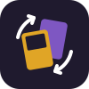
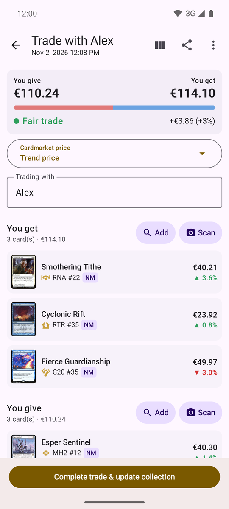
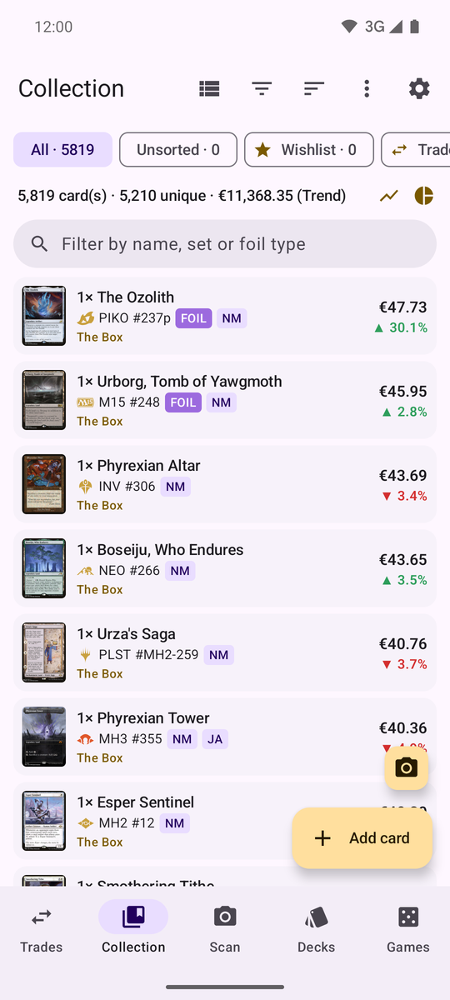
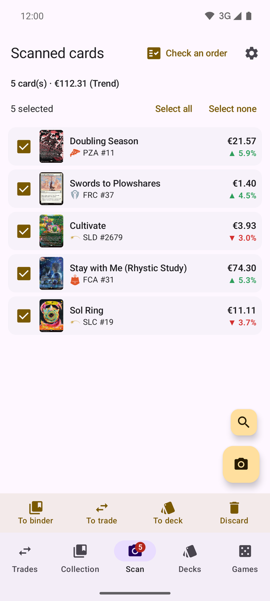
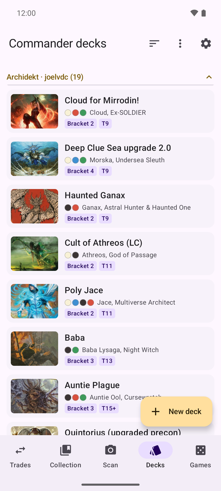
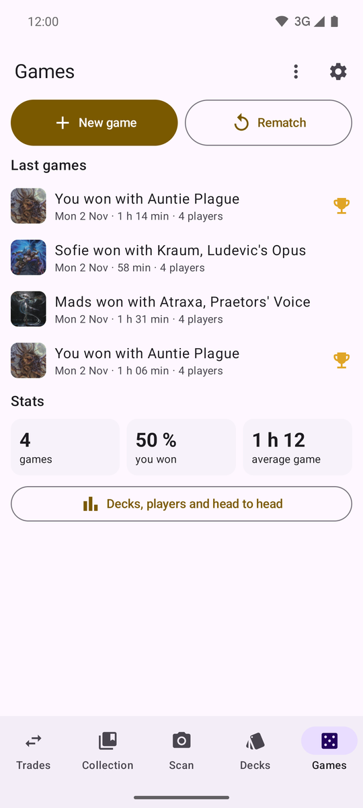
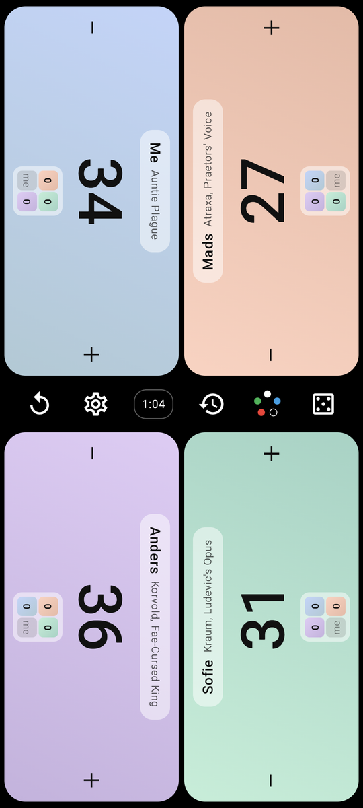
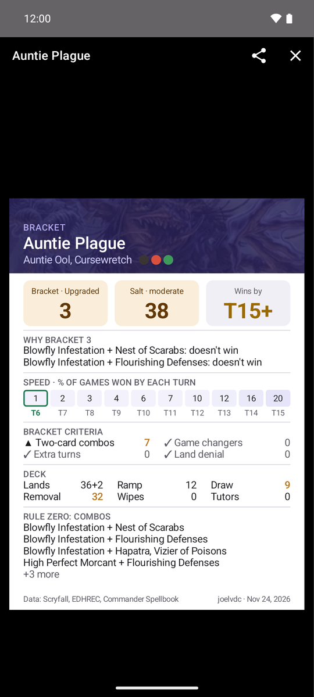
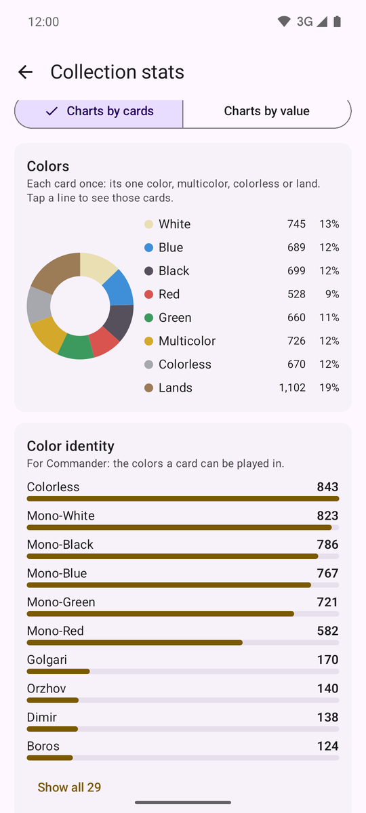

#  MTG Trader

An Android app and a website for Magic: The Gathering players: keep your collection and its value up to date, make
fair trades, follow your wishlist and orders, manage your Commander decks and keep score in your games. The phones
and the website stay in sync through your MTG Trader account.

| Trade | Collection | Scan tab | Commander decks |
|:---:|:---:|:---:|:---:|
|  |  |  |  |

| Games | Life tracker | Bracket card | Collection stats |
|:---:|:---:|:---:|:---:|
|  |  |  |  |

## Install

- **With [Obtainium](https://github.com/ImranR98/Obtainium)** (recommended): tap the button above on your phone. It
  installs the app and tells you when there's a new version.
- **By hand:** download `MTG-Trader-<version>.apk` from the
  [latest release](https://github.com/joelvdc/MTG-trading-tracker/releases/latest) and open it on your phone. Use the
  `-universal` file if that one doesn't install. Updates install over the old version and keep your data.

The app works on its own, without an account: it backs up daily to the phone or a folder you choose (let the Nextcloud
app auto-upload that folder to keep the backups on Nextcloud). An **MTG Trader account** adds sync between phones, the
website and nightly backups; accounts need an invite code and an email address (for "Forgot password?"), and can
turn on two-step login with an authenticator app.

## What it does
**Collection**
- Cards with their printing, finish, condition, language, purchase price, signed and altered, sorted into binders.
- Prices from Cardmarket, TCGplayer or Card Kingdom, in euros, Danish kroner or US dollars, optionally adjusted for
  condition. Value over time, value by set, biggest risers and fallers, what you paid against what it's worth. With an
  MTG Trader account all three come from the website's nightly copies (quicker, the same prices as the website);
  without one, or when the website can't help, straight from Scryfall, Card Kingdom and Cardmarket.
- List, compact or picture views; sort in up to three layers; filter by almost anything (MDFCs, transforming and
  split cards included). Home-screen widgets.
- Stats: colours, identities, rarity, types, mana curve, sets, finish, condition, language and more.
- CSV import and export.
- **Sort the collection** into your own levels (1 to 6 binders, best first, each with a limit and an optional minimum
  price) by value and Commander popularity, with a Decks binder for the copies your active decks use (your own
  Archidekt decks and your local decks, not retired ones; best or cheapest copies first). Copies of a card stay
  together unless one is worth far more. The trade binder and your other binders are left alone. After the first sort,
  cards only move when they clearly belong elsewhere, rest 8 weeks after a move, and at most a set number move a week
  ("Sort everything now" skips that once, e.g. after taking a deck apart); the weekly email says what to move.
- **Find cards:** paste a list or pick a deck and see where each copy is stored, binder by binder, ticking cards off as
  you pull them; copies only in other decks and cards you don't own are listed apart.

**Scanning and orders**
- Scan a pile of cards with the camera, then send them to a binder, a trade or a deck. Type what you paid for a scanned
  card and it goes along into the binder.
- Import a CardTrader or Cardmarket order with its prices, or a Commander precon. A card's page lists the orders it
  came in (date, order, copies, price each); tap one to open the order.
- **Check an order:** compare the scanned cards with the order file to find missing cards, wrong languages or
  printings, with a problem report for the shop.

**Trades**
- Both sides with their value and whether the trade is fair; completing it updates the collection.
- A **trade binder** suggests spare copies to trade, keeping what your decks need.

**Wishlist**
- To buy, ordered, received; swipe a card along and into the collection.
- Price alerts when a card drops to your price.

**Commander decks**
- Import a deck from a link (read only) or a pasted list, add a precon, or build one in the app or on the website;
  each deck's page shows when it was last modified.
- Group a deck by category, card type, mana value or colour, sorted by mana value or name; on the website, drag
  categories into your own order (the app follows it) and drag cards between categories of your own decks. Lands
  always go in the Land category, and its heading also counts the MDFCs with a land on the back, like Archidekt
  ("Land (37, 40 with MDFCs)").
- **Browse every Commander precon** on the website (Explore → Commander precons): see one with the auto categories,
  its simulated win turn, then make it your deck or add its cards to your collection.
- **Search inside a deck** with Scryfall's search words (`t:creature o:draw mv<=2`), the same in the app and on the
  website; **copy a deck as text** (Moxfield, Archidekt, MTG Arena or a plain list) and **paste cards** into one of
  your own decks, with a check first that shows what's new, what's already there and what wasn't found.
- A **primer** per deck (on its own page in the app, at the bottom of the deck page on the website, where an AI can
  write or improve it with your own OpenCode Go, Mistral or OpenRouter key), with clickable card links (`[[Sol Ring]]`; type `/` on the website to pick a card) and a **note** per card (also on shared links; a deck's Archidekt description fills an empty
  primer), **your own tags** that count in every deck, with a role line such as "Lands 37 · Ramp 11 · Draw 9"
  (`tag:ramp` in the search), **packages** (saved groups of cards to add to or take out of a deck) and a **change
  history** per deck, in the app and on the website.
- On the website: **Undo** for every deck change, **Select** to change many cards at once (category, copies,
  printing, finish), and a **playtester** to draw hands and goldfish the deck, with tokens, counters and odds.
- Every deck gets an **estimated bracket** from its list (game changers, combos from Commander Spellbook, extra turns,
  land denial), with the reasons ("Why bracket 4"), a **salt sum** like Archidekt's (lands included) with its saltiest
  cards, and a simulated **win turn**; also game changers, combos, mana stats and the chance to cast your commander on
  time.
- A **Commander legality check**: banned cards, cards outside the commander's colours, extra copies, the card count,
  and whether the commander (or a pair of partners, a Background, a Doctor and companion) may lead.
- Recommendations with the cards you already own marked, filtered by new, owned and card type, sent straight to the
  deck, its maybeboard or the wishlist (a deck from a link keeps a maybeboard of its own in the app and on the
  website); on the website also for the decks you pick at once, to find cards that fit several of them (decks whose
  list hasn't changed aren't asked about again while their recommendations are up to date; 1 day by default).
- On the website, **Compare** a deck with a public Archidekt deck, another of your decks or a pasted list: it lists the
  cards to add and to remove, matched by name so printings don't matter.
- A **bracket card** per deck for rule zero (bracket, salt, win turn, criteria, the deck's lands, ramp, draw, removal,
  wipes and tutors, game changers and combos), the same in the app and on the website, printed nine to an A4 page
  with cut marks; cards you're missing (to the wishlist),
  and retiring decks you no longer play.

**Games**
- A life tracker for 2 to 6 players with commander damage, poison, counters, turns, dice and a game clock; its menus
  follow the app's theme.
- Every game is saved, with win rates per deck and player, head to head and an overview.

**Website** ([mtgtrader.vercel.app](https://mtgtrader.vercel.app))
- The collection, wishlist, scanned cards, orders, decks and trades on a computer, with the same prices and stats as the
  app. Changes reach the phones at their next sync.
- **Share links** (from the app or the website) for a deck, a game, a binder, the whole collection or the wishlist: a
  read-only page for anyone with the link, with your prices but never what you paid. Switch links off in the website's Settings.
- **Columns:** choose and order the collection table's columns, among them how many decks use each card, the copies
  they use and the copies to spare, every price source, what you paid and the profit.
- **Trades** made, edited, completed, undone and exported on the computer too, with the app's rules.
- **Saved views** of the collection (binder, search, filter, sort, columns, grouping, layout) kept with the account;
  **Group printings** shows one line per card name; a **Spare** filter finds copies your decks don't use.
- A **price chart** in the card window, from the prices saved every night (a year back at most).
- **Themes** (Settings → Theme): System, Dark, Light, and one per basic land (Plains, Island, Swamp, Mountain,
  Forest), kept per browser.
- **Print** the collection, a binder or a deck as a list (save it as PDF).
- Decks as a list, as **Stacks** (overlapping card pictures per category) or as a **Grid** of pictures.
- **Download a copy now** of your data (Settings → Website backups); the website keeps the last 3 days of backups.
- A **weekly email** on the day you choose: your collection's value against a week ago, the week's biggest gainers and
  losers, wishlist cards at your price, and changes in your decks.

## Data
Card data and pictures from [Scryfall](https://scryfall.com); prices from Cardmarket, TCGplayer and Card Kingdom;
combos from [Commander Spellbook](https://commanderspellbook.com/); salt scores from MTGJSON (EDHREC's); recommendations from
[EDHREC](https://edhrec.com/) and [recommander.cards](https://recommander.cards/); precons from
[MTGJSON](https://mtgjson.com/); exchange rates from the European Central Bank; mana symbols from the
[Mana font](https://mana.andrewgioia.com) by Andrew Gioia.

## Building
Needs JDK 17 or 18 and the Android SDK; run `gradlew assembleDebug`. Tests: `gradlew testDebugUnitTest
verifyRoborazziDebug`. The website is in `web/` (see `web/README.md`); developer notes are in `docs/DEVELOPING.md`.
Release builds are signed with a private key that isn't in this repository, so a build of your own can't update the
official app.

## License and disclaimer
The code is under the [MIT License](LICENSE); that covers this app's code only, not the card data, names or images it
shows.

MTG Trader is unofficial Fan Content permitted under the Fan Content Policy. Not approved/endorsed by Wizards. Portions
of the materials used are property of Wizards of the Coast. ©Wizards of the Coast LLC. Not affiliated with or endorsed
by any of the data sources above. Prices are for guidance only.

The app's and website's privacy policy and terms of use are at
[mtgtrader.vercel.app/privacy](https://mtgtrader.vercel.app/privacy) and
[mtgtrader.vercel.app/terms](https://mtgtrader.vercel.app/terms). The privacy and support contact address is on the
privacy page.
